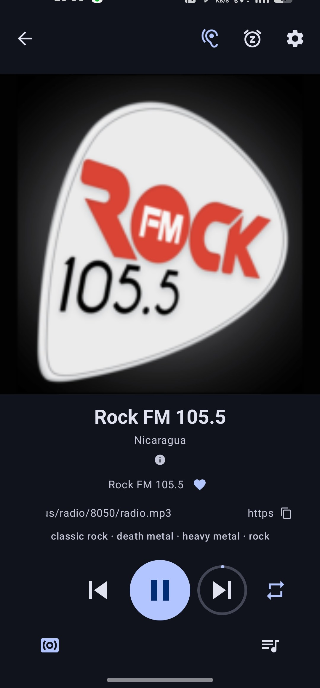
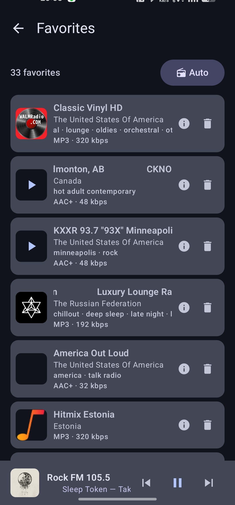
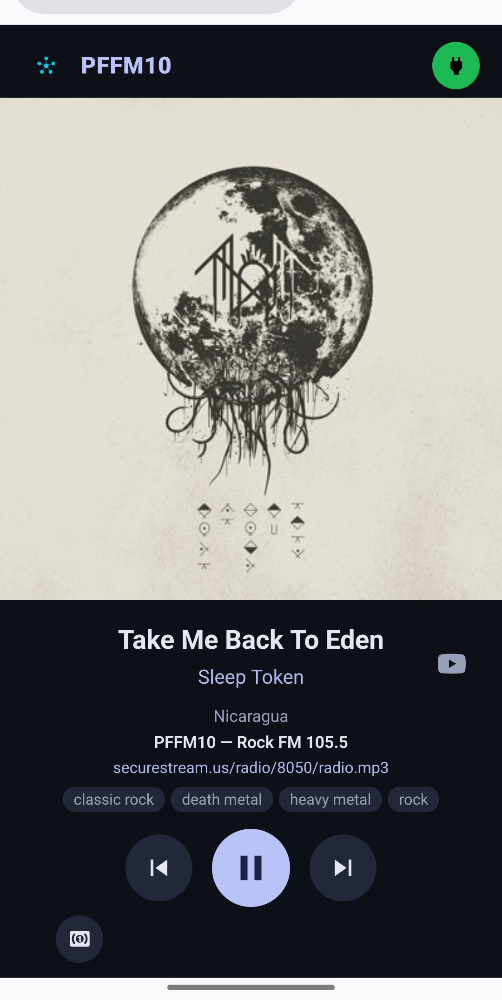
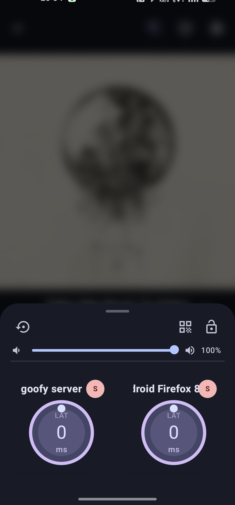
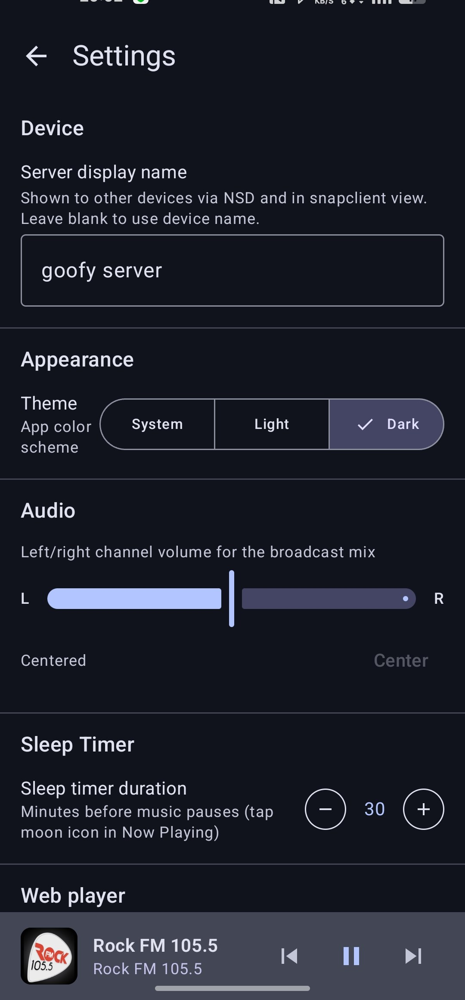

# Quantumcast

An Android internet-radio player: search a global directory of 30,000+ stations
([radio-browser.info](https://www.radio-browser.info)) by name, country, or
genre, shuffle through them on a timer, and see what's playing with track
identification. Broadcasts the audio in sync to any number of
[Snapcast](https://github.com/badaix/snapcast) devices - with a built-in web
player for browser clients, plus per-device volume, latency offset, and
left/right/stereo channel assignment. Record any station on demand (long-press play) or on a
weekly schedule, saved as the station's own MP3/AAC with a size cap that rotates out the oldest,
and play them back in-app (through Snapcast too) with resume, skip, 0.5-4× speed and smart rewind.
Favorites can be backed up, shared and merged as JSON, or exported as an M3U playlist.

## Screenshots

<p align="center">
  
  
  
  
  
</p>

Part of the **capullo-tech** audio platform. Quantumcast is the internet-radio
front-end, being recomposed onto the platform's shared libraries:

- **[capullo-audio](https://github.com/capullo-tech/capullo-audio)** - the
  delivery engine (ExoPlayer → FIFO → Snapcast server/client) and multi-device
  control.
- **[capullo-source-radiobrowser](https://github.com/capullo-tech/capullo-source-radiobrowser)** - the
  Radio Browser source (station search + stream resolution) behind the
  `capullo-audio-contracts` SPI.

The engine and the source are siblings - both implement/consume the SPI and
neither depends on the other; this app is what wires them together. See
[Platform shape](https://github.com/capullo-tech/capullo-audio-contracts#platform-shape)
for the full dependency graph.

## Playlists

Every song the track identification recognises is kept, per station, until you remove it: a
station's playlist is the songs identified on it, with their YouTube, Spotify and Apple Music links.
A song heard again on the same station updates its row (a later play counts as another detection)
instead of adding a duplicate. Delete a whole playlist, or open one and remove songs to curate it.

Other apps can read the playlists through a read-only content provider:

- Authority `tech.capullo.quantumcast.playlists`, read permission
  `tech.capullo.quantumcast.permission.READ_PLAYLISTS` (protection level `normal`). There is no
  write path.
- `content://tech.capullo.quantumcast.playlists/playlists`: one row per station that has songs,
  most recent activity first. Columns: `_id`, `station_key`, `name`, `country`, `country_code`,
  `favicon`, `stream_url`, `tags`, `codec`, `bitrate`, `track_count`, `youtube_count` (songs with a
  YouTube video link), `updated_at`.
- `.../playlists/{id}`: that one row.
- `.../playlists/{id}/tracks` and `.../tracks` (every station): last detected first. Columns:
  `_id`, `playlist_id`, `station_name`, `title`, `artist`, `artwork_url`, `youtube_url`,
  `spotify_url`, `apple_music_url`, `first_detected_at`, `last_detected_at`, `detections`.
  Times are epoch milliseconds.
- Track URIs take `?link=youtube|spotify|apple_music` to keep only rows with that link; `youtube`
  means a video link (`/watch?v=`, `youtu.be/`), not a search link.
- The projection is honoured (an unknown column throws); selection, selection arguments and sort
  order are ignored. Cursors are notified when the playlists change.
- MIME types: `vnd.android.cursor.dir/vnd.tech.capullo.quantumcast.playlist`,
  `vnd.android.cursor.item/vnd.tech.capullo.quantumcast.playlist`,
  `vnd.android.cursor.dir/vnd.tech.capullo.quantumcast.track`.

Play on a playlist hands it to CapulloTube with `ACTION_VIEW`. The data is
`content://tech.capullo.quantumcast.playlists/playlists/{id}/tracks`, the type is
`vnd.android.cursor.dir/vnd.tech.capullo.quantumcast.track` and the package is
`tech.capullo.tubecapullo`. The intent has `FLAG_GRANT_READ_URI_PERMISSION` and
`FLAG_GRANT_PREFIX_URI_PERMISSION`. The receiver can then read that playlist without the
permission, also with a query such as `?link=youtube`. The intent also has
`FLAG_ACTIVITY_NEW_TASK`, thus CapulloTube opens in its own task.

## Building

```sh
./gradlew :app:assembleDebug
```

The Snapcast native libraries come from
[`lib-snapcast-android`](https://github.com/capullo-tech/lib-snapcast-android)
via jitpack and the
[FFmpeg decoder](https://github.com/capullo-tech/lib-media3-ffmpeg-android) is
bundled - no submodules, nothing to populate.

## License

GPLv3 - see [LICENSE](LICENSE) and [NOTICE](NOTICE).
